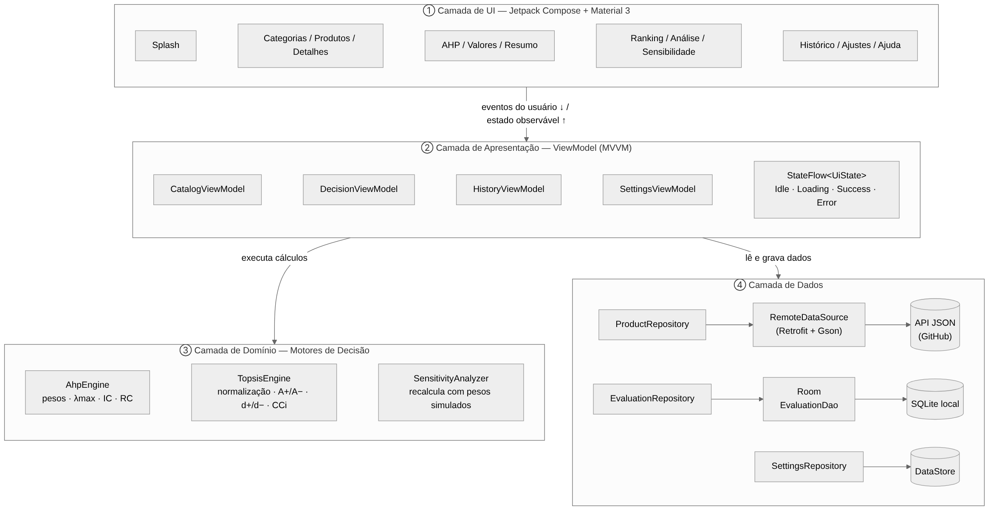

# Escolha Certa · AHP-TOPSIS

**Sistema de Avaliação Comparativa Multicritério de Produtos**
Aplicativo Android em Kotlin, com arquitetura MVVM e Jetpack Compose, que ajuda o usuário a escolher o melhor produto combinando os métodos **AHP** (pesos dos critérios) e **TOPSIS** (ranqueamento das alternativas).

> FACOM32503 – Programação para Dispositivos Móveis · Prof. Cláudio C. Rodrigues · UFU · 2026-2

## Equipe

| Integrante | Papel |
|---|---|
| Eliézer Evangelista Silva | Líder do projeto e Designer/UX |
| Luiz Eduardo Rosa Sonoda | Engenheiro de PO (AHP, TOPSIS, sensibilidade e testes) |
| Kamylla Machado Rezende | Desenvolvedora Android (Compose, navegação e ViewModels) |
| Paulo Victor Matias Ferreira | Engenheiro de Dados (API JSON, Retrofit, Room e repositórios) |

## Como funciona

1. O usuário escolhe uma categoria (**Notebooks Corporativos** ou **Smartphones Premium**) e os produtos que quer comparar.
2. **AHP:** compara os 5 critérios dois a dois na escala de Saaty (1–9). O app calcula os pesos e a Razão de Consistência; se **RC > 0,10**, o avanço é bloqueado.
3. **TOPSIS:** normaliza e pondera os valores, calcula a distância de cada produto ao ideal (d⁺) e ao anti-ideal (d⁻) e o coeficiente **CCi = d⁻ / (d⁺ + d⁻)**.
4. O ranking mostra o vencedor; a **análise de sensibilidade** permite simular outros pesos.

## Arquitetura

MVVM em quatro camadas:

- **UI** (Jetpack Compose + Material 3)
- **ViewModel** (StateFlow: Idle, Loading, Success, Error)
- **Domínio** (`AhpEngine`, `TopsisEngine`, `SensitivityAnalyzer`)
- **Dados** (API JSON via Retrofit + Gson, histórico com Room e preferências com DataStore)

## Status

| Fase | Entrega | Status |
|---|---|---|
| Fase 1 · Requisitos e modelagem | 10/11/2026 | ✅ Concluída |
| Fase 2 · Desenvolvimento e testes | 11/12/2026 | 🔜 Em andamento |

## Documentação (Fase 1)

- 📄 [Relatório da Fase 1](docs/Relatorio-Fase1-Escolha-Certa.pdf)
- 📊 [Slides da apresentação](docs/Slides-Fase1-Escolha-Certa.pdf)
- 🧭 [Diagramas](docs/diagramas) · 📱 [Telas do protótipo](docs/telas)
- 🎨 [Protótipo navegável no Figma](https://www.figma.com/proto/TieRZW5OSy6Juz26yCvBd5/AHP-TOPSIS-%E2%80%93-Prot%C3%B3tipos?node-id=18-1963&p=f&t=ecky9ucgF4jY4nY8-0&scaling=scale-down&content-scaling=fixed&page-id=1%3A2)
- 🎬 Vídeo da Fase 1: _[link do vídeo]_

## Fluxo de trabalho

- Uma **branch por funcionalidade** (ex.: `feature/ahp-engine`, `feature/tela-ranking`).
- **Pull request** para a `main`, revisado pelo líder antes do merge.
- Tarefas organizadas no quadro **AHP-TOPSIS – Cronograma** (GitHub Projects).
